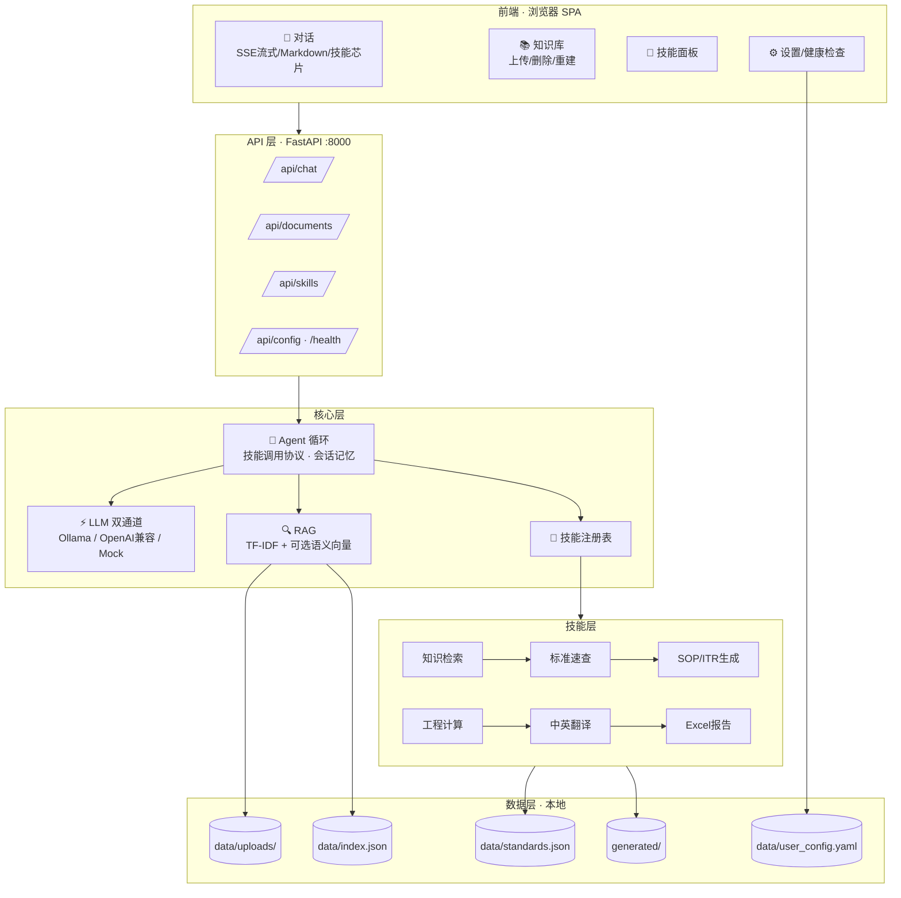

# 海工智舱 · Marine AI

面向**海洋工程 / 船舶调试**领域的本地部署大模型助手：完整前端 + 后端 + 知识库（RAG）+ 可扩展技能（Skill）体系。

- **本地优先**：支持 Ollama 完全本地推理（`qwen2.5` 等），也可切换任意 OpenAI 兼容接口（DeepSeek / 通义千问 / GLM / Moonshot）
- **零构建前端**：浏览器直接打开，无需 Node 打包
- **技能开箱即用**：知识库检索、标准速查、SOP/ITR 生成、工程计算、中英翻译、Excel 报告
- **完全离线可控**：除调用云端 API 外，所有数据（文档、索引、配置、生成文件）都在本地

---

## 1. 快速开始（Windows）

```bat
# 方式一：双击
start.bat

# 方式二：命令行
python run.py
```

打开浏览器访问 **http://127.0.0.1:8000** 即可。

> 首次运行自动安装依赖（`pip install -r requirements.txt`）。未配置任何模型时，系统自动进入 **Mock 离线模式**，可完整体验界面与链路；配置真实模型后自动生效。

### 1.1 配置模型（三选一，在页面「设置」中完成）

| 方案 | 说明 | 操作 |
|---|---|---|
| **完全本地** | 需要 8GB+ 内存，效果最佳 | 安装 [Ollama](https://ollama.com) → `ollama pull qwen2.5:14b`（可选 `ollama pull bge-m3` 启用语义检索）→ 设置页选择 `ollama` |
| **云端 API** | 免硬件，最快跑通 | 设置页选择 `openai`，填写 Base URL（如 `https://api.deepseek.com/v1`）、API Key、模型名；或设置环境变量 `MARINE_LLM_API_KEY` |
| **自动模式**（默认） | 有本地 Ollama 用本地，否则回退 API，再否则 Mock | 无需配置 |

> API Key 建议用环境变量 `MARINE_LLM_API_KEY` 注入，避免明文落盘。

### 1.2 使用流程

0. **「专业分支」**（侧边栏顶部）：按 7 大业务分类切换分支——综合助手 / 项目情报 / 标准溯源 / 电气理论 / 图纸智能 / 文书撰写 / 办公自动化 / 本地AI系统。每个分支有**专属系统提示词 + 技能集**，会话历史按分支隔离
1. **「知识库」**：拖拽上传技术文档（PDF / DOCX / XLSX / TXT / MD / CSV），自动切块建索引
2. **「对话」**：提问即可。系统自动检索知识库并标注来源；需要技能时模型自动调用（对话中显示技能芯片）
3. **「技能」**：查看/启停 6 个技能（分支内只暴露该分支的技能）
4. **「设置」**：切换模型提供方、测试连接、查看健康状态

### 1.3 示例提问

```
· 查一下知识库里关于软起动器验收标准的内容
· 帮我写一份中压断路器调试SOP（英文版，项目名LDV FSO）
· 计算 132kW 电机、电缆200米、允许压降3%、三相400V 的铜芯电缆截面
· 谐波清单：5次12%、7次8%，THD是多少？是否符合IEEE 519？
· 用IEEE 519查谐波电压限值
· 生成一份 10 条缺陷的Punch List Excel
· 把这段调试记录翻译成英文
```

---

## 2. 系统架构



- 架构高清图：`docs/architecture.html`（浏览器打开）
- 请求链路：用户 → 前端 → `/api/chat`（SSE）→ Agent（RAG 自动接地）→ 模型流式输出 → 需要技能时输出 `{"tool":"...","args":{...}}` → 执行技能 → 结果回灌 → 最终答案流式返回

---

## 2. 本地开发环境（改代码用）

> 一句话：装 VS Code → 打开项目根目录 → 改代码 → 重启后端/刷新前端。

### 2.1 环境清单

| 组件 | 要求 | 本机状态 |
|---|---|---|
| Python | ≥ 3.11（含 pip） | ✅ 3.13.13 |
| Node.js | ≥ 18（仅用于前端 JS 语法检查，非必需） | ✅ v20.20.2 |
| Git | 可选（版本管理） | ✅ 2.51.0 |
| VS Code | 推荐（代码编辑器） | ✅ 1.141.0（含 Python 调试扩展 + 中文界面） |
| Python 依赖 | `requirements.txt`（已装） | ✅ 全部 OK |

### 2.2 安装 VS Code（一次性）

```powershell
winget install Microsoft.VisualStudioCode
```

装完后在 VS Code 内安装扩展（Ctrl+Shift+X）：**Python**（微软官方，提供补全与调试）、**Chinese Language Pack**（中文界面）。

### 2.3 打开项目与启动

1. 打开 VS Code → 文件 → 打开文件夹 → 选择 `marine-ai` 项目根
2. 启动后端（二选一）：
   - 双击根目录 **`start-dev.bat`**（一键释放 8000 端口并启动）
   - 或 VS Code 按 **F5**（已配好 `.vscode/launch.json` 调试）
3. 浏览器访问 http://127.0.0.1:8000

### 2.4 编辑生效规则

| 改什么 | 怎么生效 |
|---|---|
| `frontend/` 下 html / css / js | 保存后浏览器刷新即可（必要时 URL 加 `?fresh=时间戳` 强制重载） |
| `backend/` 下 .py | 保存后重启服务（start-dev.bat 或 F5） |
| `data/branches.json`、`data/standards.json`、`config.yaml` | 重启服务后生效 |
| 页面「设置」里的配置 | 保存即生效（`data/user_config.yaml` 动态加载） |

### 2.5 常用命令（项目根目录）

```powershell
python run.py                              # 启动/重启服务（占用 8000 端口）
python -m uvicorn backend.app.main:app --host 127.0.0.1 --port 8000 --reload   # 带热重载的开发模式
node --check frontend/js/app.js            # 校验某个 JS 文件语法
```

## 3. 技能清单（v1.0）

> **分支（Branch）机制**：`data/branches.json` 定义了 8 个专业分支，每个分支绑定专属系统提示词与技能子集，会话按分支隔离。新增/调整分支只需编辑该 JSON。

| 技能 | name | 能力 | 关键实现 |
|---|---|---|---|
| 知识库检索 | `knowledge_search` | 深度检索上传文档，返回原文+来源 | 混合检索（TF-IDF 权重 0.6 + 语义 0.4） |
| 标准速查 | `standard_lookup` | IEC/IEEE/GB/ASME/API 标准定位与关键要求 | `data/standards.json` 内置索引（24 类） |
| 调试程序生成 | `sop_generator` | SOP / ITR / 调试程序起草（中/英） | 11 节规范模板 + 占位符保护 |
| 工程计算 | `calc_engine` | 电压降 / 电缆截面 / 谐波 THD / 无功补偿 / 软起动 / 谐振 | 确定性公式，输出公式+过程+结论 |
| 中英翻译 | `translate` | 海工术语表翻译 | 内置 40+ 术语 |
| Excel 报告 | `excel_report` | Punch List / 测试记录表 / 通用清单 | openpyxl 样式化输出，可下载 |

**工程计算覆盖（全部带公式与校核结论）**：
- `voltage_drop`：三相/单相线路压降（√3·I·L·(R·cosφ+X·sinφ)）
- `cable_area`：按允许压降选电缆截面 + 标准截面建议
- `harmonic_thd`：THD 计算 + IEEE 519 / GB/T 14549 限值校核
- `power_factor`：无功补偿容量 Qc 与电容值
- `soft_starter`：限流起动电流/转矩校核
- `resonance`：电容器并联谐振频率与 5/7/11/13 次风险判定

---

## 4. 项目结构

```
marine-ai/
├── config.yaml            # 基础配置（LLM/服务/RAG/技能）
├── requirements.txt       # Python 依赖
├── run.py                 # 启动入口
├── start.bat              # Windows 一键启动
├── backend/app/
│   ├── main.py            # FastAPI 入口，挂载前端
│   ├── core/              # config / llm 双通道 / embeddings
│   ├── agent/             # Agent 循环 + 技能调用协议 + 上下文
│   ├── rag/               # 解析 / 切块 / TF-IDF索引 / 混合检索
│   ├── skills/            # 技能注册表 + 6 个技能实现
│   └── api/               # chat(SSE) / documents / skills / settings
├── frontend/              # 零构建 SPA（html/css/js）
├── data/
│   ├── standards.json     # 标准速查索引
│   ├── sample/            # 演示文档
│   ├── uploads/           # 上传的文档（运行期）
│   ├── index.json         # RAG 索引（运行期）
│   └── user_config.yaml   # 页面设置覆盖层（运行期）
├── generated/             # 技能生成文件
└── docs/architecture.html # 架构图
```

---

## 5. 扩展指南：添加一个新技能

在 `backend/app/skills/` 新建文件，继承 `Skill` 基类，注册表自动发现，前端自动展示：

```python
# backend/app/skills/megger_check.py
from typing import Any, Dict
from .base import Skill

class MeggerCheckSkill(Skill):
    name = "megger_check"                       # 唯一标识（模型据此调用）
    title = "绝缘电阻判定"
    description = "根据摇测电压与读数，判定绝缘电阻是否合格并给出处置建议。"
    parameters = [
        {"name": "voltage", "type": "number", "description": "摇测电压 V", "required": True},
        {"name": "reading_mohm", "type": "number", "description": "实测绝缘电阻 MΩ", "required": True},
    ]

    async def run(self, ctx, args: Dict[str, Any]) -> Dict[str, Any]:
        v = float(args["voltage"]); r = float(args["reading_mohm"])
        limit = 1.0 if v <= 1000 else 2.0       # 示例判据
        verdict = "合格" if r >= limit else "不合格，需排查受潮/损伤"
        return {"type": "text", "content": f"摇测电压 {v}V，实测 {r}MΩ，判定：{verdict}（示例判据，以项目规范为准）。"}
```

重启服务后：技能面板出现「绝缘电阻判定」，模型可在对话中自动调用。

**技能运行结果类型**：`{"type":"text","content":"..."}`（文本）/ `{"type":"file","content":"文件名"}`（生成文件，前端自动给出下载链接）。

---

## 6. 常见问题

**Q：启动后模型提示"不可达/未配置"？**
A：未安装 Ollama 或未填 API Key。设置页点「测试连接」查看原因；或直接用 `mock` 模式体验全链路。

**Q：上传 PDF 提示"未提取到文字"？**
A：扫描件 PDF 需先 OCR（当前版本不内置 OCR）。文字版 PDF/DOCX/XLSX 均可直接解析。

**Q：想增强语义检索？**
A：安装 Ollama 后执行 `ollama pull bge-m3`，在设置页勾选「启用语义向量检索」并重新上传/重建索引（`/api/documents/reindex`）。

**Q：改端口？**
A：编辑 `config.yaml` 的 `server.port`，或 `python run.py --port 9000`。

**Q：会话历史存哪里？**
A：v1.0 为后端内存态，重启即清空；如需持久化可后续扩展（见路线图）。

---

## 7. 路线图（建议迭代方向）

- [ ] 会话历史落盘（SQLite）+ 多会话管理
- [ ] 扫描件 PDF OCR 接入（PaddleOCR 本地）
- [ ] 语义检索默认启用（内置轻量 embedding 模型）
- [ ] 技能：中压保护定值校验、电缆清册（Cable Schedule）Excel、ITR 套表生成
- [ ] 联网检索技能（标准原文溯源、厂家手册查询）
- [ ] 文档版本管理与增量索引
- [ ] Docker / WSL 一键部署

---

## 8. 技术要点

- **零重依赖向量检索**：中文按相邻二元组分词 + 英文按词，TF-IDF 纯 Python 实现（无 numpy/torch），2000 块内毫秒级响应
- **技能调用协议**：模型输出单行 JSON `{"tool","args"}`，正则容错解析（支持代码块包裹），单轮最多 4 次连续调用
- **RAG 防幻觉**：知识上下文注入系统提示并要求标注 `[来源:文件名]`；技能标准速查明确"以官方原文为准"
- **安全**：API Key 不回传前端明文（脱敏显示）、不写日志；生成文件下载路径做越界校验
- **提示词工程**：SOP/翻译技能使用独立系统提示与海工术语表，输出符合行业书面语
